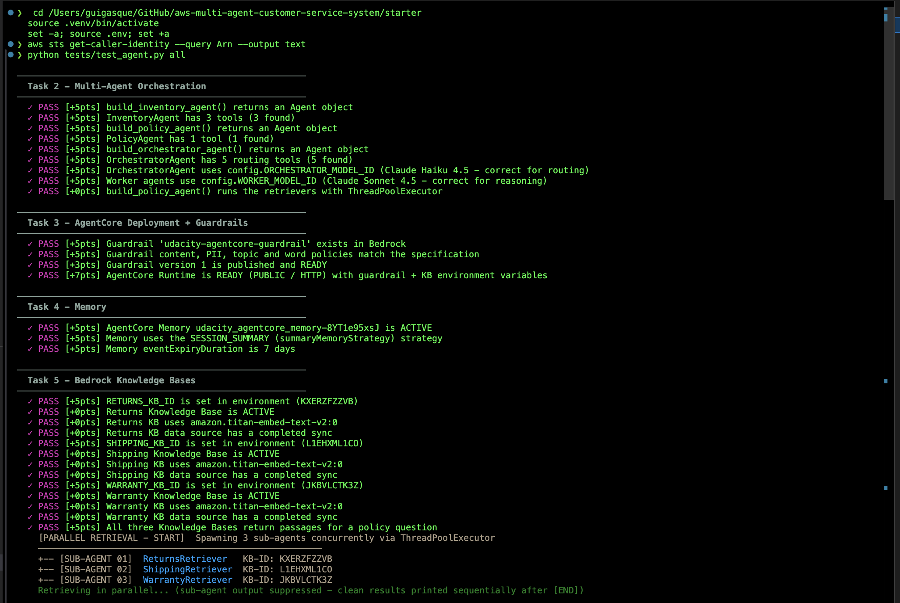
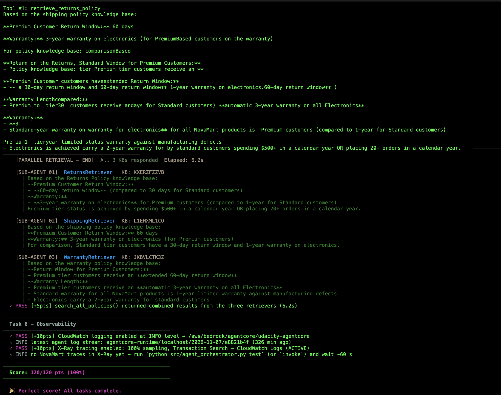
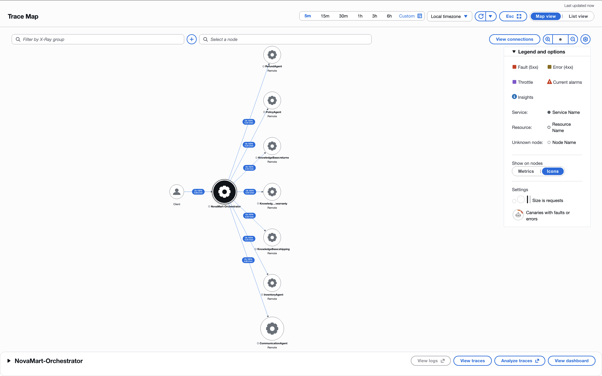
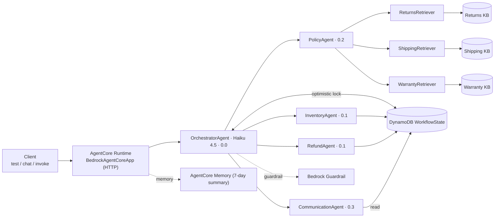
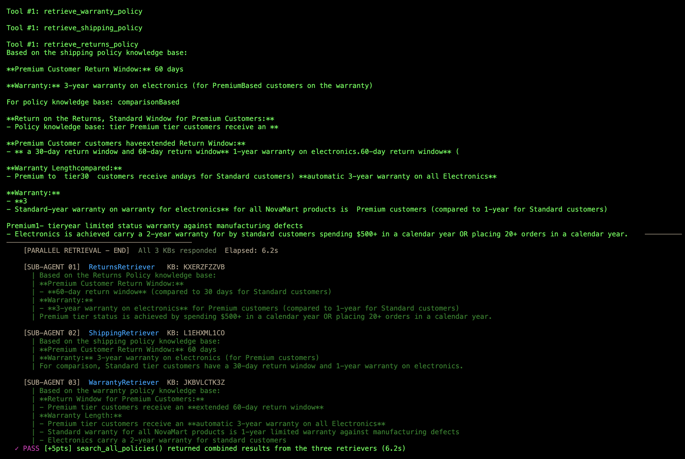

# NovaMart Multi-Agent Customer Support — Evidence

**Amazon Bedrock AgentCore · Strands Agents SDK · Claude Haiku 4.5 (routing) + Sonnet 4.5 (workers)**

A customer support system for the fictional store NovaMart. One OrchestratorAgent reads each request
and hands it to the right specialist — Inventory, Policy (which fans out to three Knowledge Bases),
Refund, or Communication. The workers don't talk to each other; they share a single DynamoDB
`WorkflowState` record. It runs on AgentCore Runtime with a Bedrock Guardrail, AgentCore Memory, and
CloudWatch/X-Ray tracing. The AWS resources are created and torn down by code.

`python tests/test_agent.py all` → **120/120**.

| | |
|---|---|
| Runtime | `udacity_agentcore_runtime` |
| ARN | `…:runtime/udacity_agentcore_runtime-gNqtAS68uD` (us-east-1, acct 053471543567) |
| Models | Orchestrator `us.anthropic.claude-haiku-4-5` · Workers `us.anthropic.claude-sonnet-4-5` |
| Infrastructure | CloudFormation + boto3 + AgentCore CLI (no console steps) |
| More | [How it works](../starter/docs/HOW_IT_WORKS.md) · [Architecture](../starter/docs/ARCHITECTURE.md) · [Build log](../starter/docs/BUILD_LOG.md) · [How to run](../starter/docs/HOW_TO_RUN.md) |

---

## Score

| Task | What it checks | Points |
|---|---|---|
| 2 — Multi-agent graph | 5 agents, tools, models, parallel RAG, routing | 40/40 |
| 3 — Guardrail + runtime | Guardrail policies + AgentCore Runtime READY | 20/20 |
| 4 — Memory | AgentCore Memory, session summary, 7-day | 15/15 |
| 5 — Knowledge Bases | 3 KBs ACTIVE/synced + parallel retrieval | 20/20 |
| 6 — Observability | CloudWatch INFO logs + X-Ray 100% sampling | 20/20 |
| | | **120/120** |

The grader reads live AWS state for Tasks 3–6 (guardrail policy values, runtime status and env vars,
the memory resource, KB ingestion status, X-Ray/CloudWatch config) — those checks aren't mocked.

Top of the run and the final score:





X-Ray Service Map after `python src/agent_orchestrator.py test` — the orchestrator connected to the
four workers and the three Knowledge Base nodes:



---

## Architecture

The orchestrator (Haiku, temperature 0 so routing is repeatable) hands each request to the Sonnet
workers. PolicyAgent is itself three retriever sub-agents that run at the same time, one per Knowledge
Base. Nothing passes between workers directly — each reads and writes the shared `WorkflowState` item,
which uses a `version` field so two writes can't overwrite each other. The guardrail sits on every
agent's model.



The rest of the diagrams — request flow, routing rules, parallel RAG, KB ingestion, the WorkflowState
lock, the deploy order, config, and tracing — are in
[`../starter/docs/ARCHITECTURE.md`](../starter/docs/ARCHITECTURE.md).

A request goes: `initialize_session` creates the `WorkflowState` item (version 0); the orchestrator
routes by intent and each worker reads the current state, does its part, and writes its result back
under its own column with a version bump; `route_to_communication_agent` runs last and writes the
reply. The orchestrator never writes the customer-facing text itself.

---

## What was tested

### Scenario 1 — Return (CUST-001, ORD-27176)
Prompt: *"I want to return my wireless headphones from order ORD-27176"*

Routes `initialize_session → inventory → refund → communication`. Inventory finds the order
(delivered, Wireless Headphones Pro) and the Premium tier; Refund applies the 60-day Premium window,
finds it eligible, and issues a return reference (e.g. `RET-8CA64698`); Communication writes the
reply. All four worker nodes show up in the trace.

### Scenario 2 — Policy question (CUST-002)
Prompt: *"What is the return policy for premium customers?"*

Routes `initialize_session → policy → communication`. `search_all_policies` queries the three KBs at
once — ReturnsRetriever (`KXERZFZZVB`), ShippingRetriever (`L1EHXML1CO`), WarrantyRetriever
(`JKBVLCTK3Z`) — and the answer stays grounded in what they return: 60-day Premium window, 3-year
electronics warranty, free expedited shipping. All three `KnowledgeBase:*` nodes appear in the trace.
The three retrievals overlap, so the whole fan-out takes about as long as one of them (~6–10s) rather
than three in a row.



### Scenario 3 — Math (CUST-003)
Prompt: *"How much would 5 items at $29.99 be with a 10% discount?"*

Routes `initialize_session → communication` and skips Inventory/Policy/Refund. Answer: 5 × $29.99 =
$149.95, minus 10% = **$134.96**. The point of this scenario is that the guardrail has to let the
arithmetic through (see below).

### Guardrail
Checked directly with the ApplyGuardrail API:

| Input | Action |
|---|---|
| "How much is 5 items at $29.99 with a 10% discount?" | `NONE` — allowed (input and output) |
| "Can you lower the price? I want to haggle." | `GUARDRAIL_INTERVENED` — blocked |
| "Is Amazon's version cheaper and better?" | `GUARDRAIL_INTERVENED` — blocked |
| "I'll sue NovaMart if you don't refund me." | `GUARDRAIL_INTERVENED` — blocked |

The "pricing negotiations" topic is written narrowly — haggling or asking to change an advertised
price — and says in so many words that it does not cover arithmetic on a price and discount that are
already given. Without that wording the Classic tier blocked the math scenario; this is the one thing
in the guardrail config that needed care.

### Deployed runtime
```
python src/agent_orchestrator.py invoke "What is the return policy for premium customers?" CUST-002
```
Goes through the actual AgentCore Runtime (not the local path) and comes back with a grounded,
guardrailed reply and an X-Ray trace.

---

## Infrastructure

Everything is created and deleted from code — there are no console steps.

```bash
# Foundation (once)
aws cloudformation deploy --template-file infrastructure/starter_stack.yaml \
  --stack-name udacity-agentcore --capabilities CAPABILITY_NAMED_IAM --region us-east-1
python infrastructure/seed_data.py

# Knowledge Bases (describe-or-create, sync, write the IDs into .env)
python infrastructure/create_knowledge_bases.py

# Guardrail, runtime, memory, observability
python src/agent_orchestrator.py deploy

# Teardown
python infrastructure/cleanup.py --yes
```

What this run provisioned:

| Resource | Identifier |
|---|---|
| Foundation stack | `udacity-agentcore` (CREATE_COMPLETE) |
| Returns KB | `KXERZFZZVB` (S3 Vectors, Titan Embed Text v2) |
| Shipping KB | `L1EHXML1CO` |
| Warranty KB | `JKBVLCTK3Z` |
| Guardrail | `udacity-agentcore-guardrail` → `y7qxjyotoito` version 1 |
| AgentCore Runtime | `udacity_agentcore_runtime-gNqtAS68uD` (READY, PUBLIC, HTTP) |
| AgentCore Memory | `udacity_agentcore_memory-8YT1e95xsJ` (session summary, 7-day) |
| Vector store | `udacity-agentcore-vectors-053471543567-b71f0d60` + 3 indexes (1024-dim, cosine) |

The KBs sit on S3 Vectors rather than OpenSearch Serverless — easier to script and nothing bills while
it's idle.

---

## Notes on the implementation

- Workers share one DynamoDB `WorkflowState` item instead of calling each other. Writes are guarded by
  a `version` field (optimistic lock), so a request is readable from one record and two concurrent
  writes don't clobber each other — the loser re-reads and retries.
- `search_all_policies` runs the three retrievers with `ThreadPoolExecutor(max_workers=3)` +
  `as_completed()` instead of one after another.
- The guardrail uses the STANDARD tier and a cross-region profile; the "pricing negotiations" topic is
  scoped so the math scenario passes (confirmed with the ApplyGuardrail probes above).
- `create_knowledge_bases.py` is safe to re-run — it reuses KBs that already exist and writes the IDs
  back into `.env`. The S3 Vectors create call rejects `indexArn` and `indexName` together; the fix
  (pass only `indexArn`) is in the build log.
- The DynamoDB and retrieval tools catch their own errors and return a readable message rather than
  throwing into the agent loop.
- Dependencies are pinned, provisioning is idempotent, and teardown is one command.

The things that went wrong along the way — the wrong IAM account at the start, the sandbox token
expiring mid-run, the S3 Vectors create quirk — are in
[`../starter/docs/BUILD_LOG.md`](../starter/docs/BUILD_LOG.md).

---

## Reproduce

```bash
cd starter && source .venv/bin/activate && set -a; source .env; set +a

# Grader
python tests/test_agent.py all

# Three scenarios locally (also publishes the X-Ray traces)
python src/agent_orchestrator.py test

# Deployed runtime
python src/agent_orchestrator.py invoke "What is the return policy for premium customers?" CUST-002
python src/agent_orchestrator.py invoke "I want to return my order ORD-27176" CUST-001
```

For the Service Map: CloudWatch → X-Ray traces → Service map → "Last 15 minutes" (give it 30–60s
after a run). You should see `NovaMart-Orchestrator` linked to InventoryAgent, RefundAgent,
PolicyAgent, CommunicationAgent, and the three `KnowledgeBase:*` nodes.

---

## Files here

| File | What it shows |
|---|---|
| `t1.png` | `test_agent.py all` — Tasks 2/3/4 and the Task 5 KB checks passing |
| `t2.png` | The three retrievers returning and `search_all_policies` passing |
| `t-final.png` | Task 6 passing and the 120/120 total |
| `x-ray.png` | The Service Map — orchestrator, workers, Knowledge Bases |

Only non-secret identifiers appear in the screenshots (session, request, and trace IDs, the account
ID, resource IDs) — no credentials.
