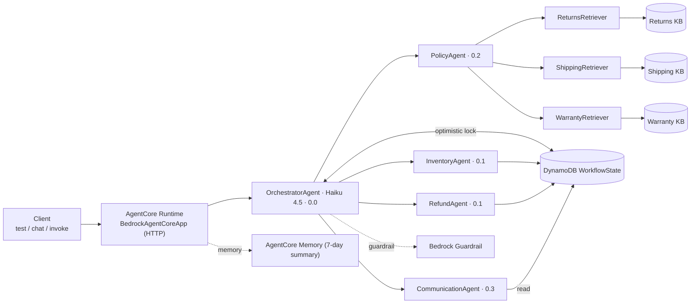

# NovaMart Multi-Agent Customer Support — Project Report & Evidence

**Amazon Bedrock AgentCore · Strands Agents SDK · Claude Haiku 4.5 (routing) + Sonnet 4.5 (workers)**

A production-minded multi-agent customer support system for the fictional e-commerce company NovaMart.
A single OrchestratorAgent understands each request and routes it to four specialist worker agents —
Inventory, Policy (parallel multi-agent RAG over three Knowledge Bases), Refund, and Communication —
that share state through a DynamoDB `WorkflowState` record. Deployed to AgentCore Runtime with a
Bedrock Guardrail, AgentCore Memory, and CloudWatch/X-Ray observability. Every capability is
provisioned as code and verified end-to-end.

**✅ `python tests/test_agent.py all` → 120/120 (100%).**

| | |
|---|---|
| **Runtime** | `udacity_agentcore_runtime` |
| **ARN** | `…:runtime/udacity_agentcore_runtime-gNqtAS68uD` (us-east-1, acct 053471543567) |
| **Models** | Orchestrator `us.anthropic.claude-haiku-4-5` · Workers `us.anthropic.claude-sonnet-4-5` |
| **Infrastructure** | 100% provisioned as code (CloudFormation + boto3 + AgentCore CLI) — no console clicks |
| **More** | [How it works](../starter/docs/HOW_IT_WORKS.md) · [Architecture](../starter/docs/ARCHITECTURE.md) · [Build log](../starter/docs/BUILD_LOG.md) · [How to run](../starter/docs/HOW_TO_RUN.md) |

---

## Results at a glance

| Area | Under test | Points | Result |
|---|---|---|---|
| Task 2 — Multi-agent graph | 5 agents, tools, models, parallel RAG, routing | 40/40 | ✅ |
| Task 3 — Guardrail + runtime | Bedrock Guardrail policies + AgentCore Runtime READY | 20/20 | ✅ |
| Task 4 — Memory | AgentCore Memory, session summary, 7-day | 15/15 | ✅ |
| Task 5 — Knowledge Bases | 3 KBs ACTIVE/synced + parallel retrieval | 20/20 | ✅ |
| Task 6 — Observability | CloudWatch INFO logs + X-Ray 100% sampling | 20/20 | ✅ |
| **Total** | | **120/120** | ✅ |

Screenshots: `test_120_score_part1.png` + `test_120_score_part2.png` (grader) · `x-ray.png` (Service Map).

---

## Architecture

One OrchestratorAgent (Haiku, deterministic routing) delegates to four Sonnet workers; PolicyAgent
fans out to three retriever sub-agents in parallel. Workers never call each other — they share one
DynamoDB `WorkflowState` item with optimistic locking. The guardrail is attached to every agent's
model.



Full diagram set (request flow, routing, parallel RAG, ingestion, WorkflowState, provisioning, config,
observability) is in [`../starter/docs/ARCHITECTURE.md`](../starter/docs/ARCHITECTURE.md).

### How a request flows
1. `initialize_session` creates a blank `WorkflowState` item keyed by `session_id` (version 0).
2. The orchestrator routes on intent; each worker reads the current state, does its job, and its
   output is written back under its column with an optimistic-lock version bump.
3. `route_to_communication_agent` always runs last and composes the only customer-facing reply — the
   orchestrator never writes it.

---

## Test evidence

The grader (`python tests/test_agent.py all`) reads real AWS state for Tasks 3–6 (guardrail policy
values, runtime status/env, memory resource, KB ingestion, X-Ray/CloudWatch config) — nothing mocked.

### Scenario 1 — Return (CUST-001, ORD-27176)
- **Prompt:** "I want to return my wireless headphones from order ORD-27176"
- **Routing:** `initialize_session → route_to_inventory_agent → route_to_refund_agent → route_to_communication_agent`
- **Result:** ✅ Inventory read the order (delivered, Wireless Headphones Pro) and Premium tier →
  Refund applied the 60-day window, eligible, issued a return reference (e.g. `RET-8CA64698`) →
  Communication wrote the reply. All four worker X-Ray nodes present.

### Scenario 2 — Policy question (CUST-002)
- **Prompt:** "What is the return policy for premium customers?"
- **Routing:** `initialize_session → route_to_policy_agent → route_to_communication_agent`
- **Path:** PolicyAgent → `search_all_policies` fans out to ReturnsRetriever (`KXERZFZZVB`),
  ShippingRetriever (`L1EHXML1CO`), WarrantyRetriever (`JKBVLCTK3Z`) **in parallel** (ThreadPoolExecutor)
- **Result:** ✅ Grounded answer — 60-day Premium return window, 3-year electronics warranty, free
  expedited shipping. Three `KnowledgeBase:*` X-Ray nodes present. (~6–10s, parallel not serial.)

### Scenario 3 — Math (CUST-003)
- **Prompt:** "How much would 5 items at $29.99 be with a 10% discount?"
- **Routing:** `initialize_session → route_to_communication_agent` (skips Inventory/Policy/Refund)
- **Result:** ✅ 5 × $29.99 = $149.95, −10% = **$134.96**. Critically, the guardrail **allows** this
  arithmetic (see below).

### Guardrail behavior (ApplyGuardrail probe)
| Input | Action |
|---|---|
| "How much is 5 items at $29.99 with a 10% discount?" | `NONE` (allowed) — input **and** output |
| "Can you lower the price? I want to haggle." | `GUARDRAIL_INTERVENED` (blocked) |
| "Is Amazon's version cheaper and better?" | `GUARDRAIL_INTERVENED` (blocked) |
| "I'll sue NovaMart if you don't refund me." | `GUARDRAIL_INTERVENED` (blocked) |

The "pricing negotiations" DENY topic is defined narrowly (haggling / changing an advertised price)
and explicitly excludes arithmetic with an already-stated price and discount — avoiding the known
false-positive that would otherwise block the math scenario.

### Deployed-runtime invocation (full production path)
```
python src/agent_orchestrator.py invoke "What is the return policy for premium customers?" CUST-002
```
✅ Returned a grounded, guardrailed reply through AgentCore Runtime (not just local), with a published
X-Ray trace.

---

## Infrastructure as code (no console)

Every AWS resource is created and destroyed by code. One command each way for provisioning, the
pipeline, and teardown:

```bash
# Foundation (once)
aws cloudformation deploy --template-file infrastructure/starter_stack.yaml \
  --stack-name udacity-agentcore --capabilities CAPABILITY_NAMED_IAM --region us-east-1
python infrastructure/seed_data.py

# Knowledge Bases — by code (describe-or-create, sync, write .env)
python infrastructure/create_knowledge_bases.py

# Guardrail → runtime → memory → observability
python src/agent_orchestrator.py deploy

# Teardown (idempotent, reverse order)
python infrastructure/cleanup.py --yes
```

**Provisioned for this run:**

| Resource | Identifier |
|---|---|
| Foundation stack | `udacity-agentcore` (CREATE_COMPLETE) |
| Returns KB | `KXERZFZZVB` (S3 Vectors, Titan Embed Text v2) |
| Shipping KB | `L1EHXML1CO` |
| Warranty KB | `JKBVLCTK3Z` |
| Guardrail | `udacity-agentcore-guardrail` → `y7qxjyotoito` version **1** |
| AgentCore Runtime | `udacity_agentcore_runtime-gNqtAS68uD` (READY, PUBLIC, HTTP) |
| AgentCore Memory | `udacity_agentcore_memory-8YT1e95xsJ` (session summary, 7-day) |
| Vector store | `udacity-agentcore-vectors-053471543567-b71f0d60` + 3 indexes (1024-dim, cosine) |

**Design choice worth noting:** the KBs are backed by **S3 Vectors** instead of OpenSearch
Serverless — simpler to script and no always-on idle cost.

---

## Engineering highlights

- **Shared state, not chatter** — workers never call each other; they coordinate through one DynamoDB
  `WorkflowState` item with version-based optimistic locking, so the whole request is auditable from a
  single record and concurrent writes can't clobber each other.
- **Parallel multi-agent RAG** — `search_all_policies` fans out to three retriever sub-agents via
  `ThreadPoolExecutor(max_workers=3)` + `as_completed()`, so three-KB latency ≈ the slowest single
  retrieval, not the sum.
- **Guardrail tuned for the real workload** — STANDARD safeguard tier + cross-region profile, with
  "pricing negotiations" scoped so legitimate arithmetic passes while haggling/competitor/legal-threat
  are blocked (verified by direct ApplyGuardrail probes).
- **KBs by code** — a new idempotent `create_knowledge_bases.py` provisions the three S3 Vectors KBs
  and writes their IDs back into `.env`; the one API quirk hit (S3 Vectors rejects `indexArn` +
  `indexName` together) is documented in the build log with its fix.
- **Graceful tools** — DynamoDB and retrieval tools catch specific exceptions and return readable
  messages, so one flaky lookup never sinks a conversation.
- **Reproducible, reversible** — pinned deps, idempotent provisioning, one-command teardown.

The debugging story (wrong initial IAM account, sandbox token expiry, the S3 Vectors KB API quirk) is
written up in [`../starter/docs/BUILD_LOG.md`](../starter/docs/BUILD_LOG.md).

---

## Reproduce

```bash
cd starter && source .venv/bin/activate && set -a; source .env; set +a

# Grader (120/120)
python tests/test_agent.py all

# Three scenarios locally (publishes X-Ray traces for the Service Map)
python src/agent_orchestrator.py test

# Deployed runtime
python src/agent_orchestrator.py invoke "What is the return policy for premium customers?" CUST-002
python src/agent_orchestrator.py invoke "I want to return my order ORD-27176" CUST-001
```

**X-Ray Service Map:** AWS Console → CloudWatch → X-Ray traces → Service map → "Last 15 minutes"
(allow 30–60s after a run). Shows `NovaMart-Orchestrator` → InventoryAgent / RefundAgent / PolicyAgent
/ CommunicationAgent → KnowledgeBase:returns / :shipping / :warranty.

---

## Files in this folder

| File | What it shows |
|---|---|
| `t1.png` | `test_agent.py all` — Tasks 2/3/4 + Task 5 KB checks PASS |
| `t2.png` | Parallel retrieval detail — all three retrievers return, `search_all_policies` PASS |
| `t-final.png` | Task 6 PASS and **Score: 120/120 pts (100%)** |
| `x-ray.png` | X-Ray Service Map — full Orchestrator → worker → KnowledgeBase call chain |

Screenshots use non-secret identifiers only (session/request/trace IDs, account ID, resource IDs); no
credentials are shown.
