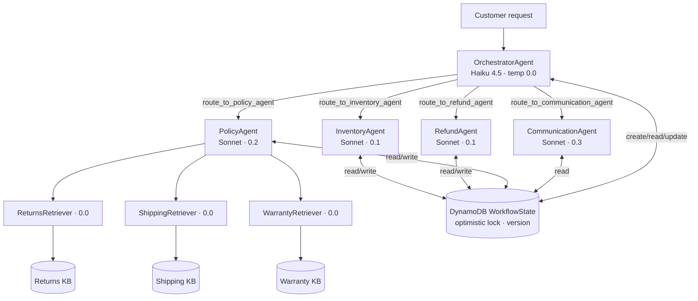

# Design — NovaMart Multi-Agent Customer Support System

## Overview

Five Strands agents in an Orchestrator → Workers hierarchy, deployed to Amazon Bedrock AgentCore
Runtime. The Orchestrator (fast Haiku model, deterministic routing) owns a shared DynamoDB
`WorkflowState` record and delegates every unit of work to a specialist worker (Sonnet). Workers never
talk to each other directly — they communicate through WorkflowState, which the Orchestrator reads and
writes with optimistic locking. The only file we implement is `src/agent_orchestrator.py`; everything
else is either pre-written infrastructure or new, clearly-separated provisioning scripts.



## Architecture layers

| Layer | Component | Source | Our work |
|---|---|---|---|
| Foundation infra | DynamoDB ×3, S3 policy bucket, S3 Vectors bucket + 3 indexes, IAM exec role, CW log group | `infrastructure/starter_stack.yaml` | **Run as-is** (never edit) |
| Seed data | 4 customers, orders, policy docs in S3 | `infrastructure/seed_data.py` | Run as-is |
| Agent graph | 5 agents + routing tools | `src/agent_orchestrator.py` | **Implement TODOs** |
| Guardrail / runtime / memory / observability | deploy pipeline | `src/agent_orchestrator.py` | **Implement TODOs** |
| Knowledge Bases | 3 Bedrock KBs over S3 Vectors | `infrastructure/create_knowledge_bases.py` (NEW) | **Write** (console fallback) |
| Observability/tracing plumbing | X-Ray segments, CW handler, `apply_observability_config` | `src/agent_observability.py` | Use as-is |
| Deploy plumbing | stage/configure/deploy/arn | `src/agentcore_cli.py` | Call as-is |
| KB retrieval | `retrieve_from_knowledge_base` | `src/bedrock_kb_retrieval.py` | Call as-is |
| Config | lazy CF-export loader | `config.py` | Read-only |
| Tests | 120-pt grader | `tests/test_agent.py` | Read-only |

## Key design decisions

### D1 — `@tool` comes from `agent_observability`, not `strands`
The project re-exports a traced `tool` decorator. Every agent tool must use it so that `route_to_*`
tool names become worker nodes on the X-Ray Service Map and `search_all_policies` is recognized as a
fan-out tool. The import block for this is already present in the starter.

### D2 — WorkflowState is the only inter-agent channel
Routing tools follow a fixed shape: read current state (`_read_workflow_state`) → invoke worker →
persist with `_update_workflow_state(session_id, {column: text}, expected_version)`. Columns:
`inventory_agent`, `policy_agent`, `refund_agent`, `communication_agent`. The record is keyed by
`session_id`; `version` increments on every write (conditional update, retried on conflict). This keeps
workers stateless and makes the whole request auditable from one DynamoDB item.

### D3 — Model/temperature matrix (from config, never hardcoded)
| Agent | Model constant | Temp | Why |
|---|---|---|---|
| Orchestrator | `ORCHESTRATOR_MODEL_ID` (Haiku) | 0.0 | deterministic routing |
| Inventory | `WORKER_MODEL_ID` (Sonnet) | 0.1 | accurate fact lookup |
| Refund | `WORKER_MODEL_ID` | 0.1 | consistent policy application |
| Policy retrievers ×3 | `WORKER_MODEL_ID` | 0.0 | deterministic retrieval |
| Policy coordinator | `WORKER_MODEL_ID` | 0.2 | light synthesis |
| Communication | `WORKER_MODEL_ID` | 0.3 | warm, natural tone |

### D4 — Parallel RAG with ThreadPoolExecutor
`search_all_policies` builds `{domain: retriever_agent}`, calls `trace.kb_start({...})`, then submits
each retriever to `ThreadPoolExecutor(max_workers=3)` and gathers via `as_completed()`. The
`_run_retriever(domain, agent, query)` helper runs one sub-agent and returns `(domain, text)`; stdout
is globally suppressed during the parallel section (a flag set by `kb_start`) because Strands spawns
internal streaming threads that don't inherit thread-local state. Results are printed sequentially by
`trace.kb_result()` after the futures join. The grader statically asserts `ThreadPoolExecutor` + a
`submit`/`map` call in `build_policy_agent`.

### D5 — Guardrail tier + the math false-positive
Use the STANDARD safeguard tier (`tierConfig`) and the cross-region profile
(`crossRegionConfig={'guardrailProfileIdentifier':'us.guardrail.v1:0'}`). The "pricing negotiations"
DENY topic is defined narrowly — haggling or asking to change an advertised price — and explicitly
excludes arithmetic using an already-stated price and discount, so the required
`5 × $29.99 with 10% off` scenario (and its answer) passes while "beat your competitor's price",
competitor mentions, and legal threats are blocked. Guardrail is promoted to a **numbered** version;
`_apply_guardrail()` (pre-written) attaches it to every agent's `BedrockModel` via env vars.

### D6 — Deploy ordering
`deploy_all()` already sequences: build graph → `create_guardrail` → `deploy_to_agentcore_runtime` →
`configure_memory` → `configure_observability` → optional gateway (skipped). This ordering is load-
bearing: `apply_observability_config()` (called by `configure_observability`) re-runs
`configure_runtime` + `agentcore deploy` to push env vars, so it must run **after** the initial runtime
deploy. We implement the functions; we do not reorder the pipeline.

### D7 — Knowledge Bases by code (S3 Vectors)
`infrastructure/create_knowledge_bases.py` (new, outside the do-not-modify set) uses boto3
`bedrock-agent` to describe-or-create three KBs against the **existing** vector bucket/indexes from the
stack (dimension 1024, cosine, `AMAZON_BEDROCK_TEXT`), create S3 data sources on the three prefixes,
start ingestion, poll to COMPLETE, and write the three IDs into `.env`. The KB needs a service role
assumable by `bedrock.amazonaws.com` with access to the data bucket, the vector bucket, and
`bedrock:InvokeModel` on the Titan embedder. **Before** relying on this, verify the S3 Vectors
`create_knowledge_base` request shape and the required IAM against the installed boto3 (1.43.126); if
the API or sandbox permissions don't support it cleanly, fall back to the documented Console runbook
and record that in the build log. Teardown is already handled by `cleanup.py` (it discovers KBs by the
`novamart-` name prefix).

### D8 — Credentials & config loading
Temporary sandbox creds (key/secret/session-token) live in `starter/.env`. Python picks them up via
`config.py`'s `load_dotenv()`; shell CLI calls load them with `set -a; source .env; set +a`. When the
token expires, AWS calls return `ExpiredToken`/`ExpiredTokenException` — the operator refreshes the
three values in `.env` and the step is re-run (every provisioning step is idempotent).

## Interfaces (functions we implement in `agent_orchestrator.py`)

```python
def build_inventory_agent() -> Agent: ...
def build_refund_agent() -> Agent: ...
def build_policy_agent() -> Agent: ...
def build_communication_agent() -> Agent: ...
def build_orchestrator_agent(inventory, refund, policy, communication) -> Agent: ...

def create_guardrail() -> tuple[str, str]: ...                      # (id, numbered_version)
def deploy_to_agentcore_runtime(orchestrator, guardrail_id, guardrail_version) -> str: ...  # arn
def configure_memory(runtime_arn: str) -> str: ...                  # memory arn
def configure_observability(runtime_arn: str) -> None: ...
```

Routing/worker tools (all decorated with the traced `@tool`):
`check_order_status`, `get_customer_tier`, `list_customer_orders`, `get_inventory_context`,
`initiate_refund`, `retrieve_returns_policy`/`retrieve_shipping_policy`/`retrieve_warranty_policy`,
`search_all_policies`, `get_full_workflow_context`, `initialize_session`, `route_to_inventory_agent`,
`route_to_policy_agent`, `route_to_refund_agent`, `route_to_communication_agent`.

## Error handling
- DynamoDB tools: catch `ClientError`/`KeyError`, return a readable `{"error": ...}` / not-found dict
  rather than raising into the agent loop.
- Retriever tools: `retrieve_from_knowledge_base` already returns a structured error entry on failure;
  surface it as text, don't crash the fan-out.
- Deploy/guardrail/memory functions: fail readable with the real AWS error; `configure_observability`
  wraps `apply_observability_config` in try/except per the stub contract.
- Idempotency: guardrail/memory/runtime/KB creation all describe-or-create by deterministic name so
  re-running `deploy` (or the KB script) is a safe no-op.

## Testing strategy
- **Task 2** is fully local (DynamoDB reads only) — run after each of waves 2–4.
- **Tasks 3–6** read real AWS state and require the full deploy — run after wave 8.
- Verify behavior, not just exit codes: inspect returned records, guardrail read-backs (ApplyGuardrail
  probe for the math/negotiation cases), KB ingestion status, and the live X-Ray trace id.
