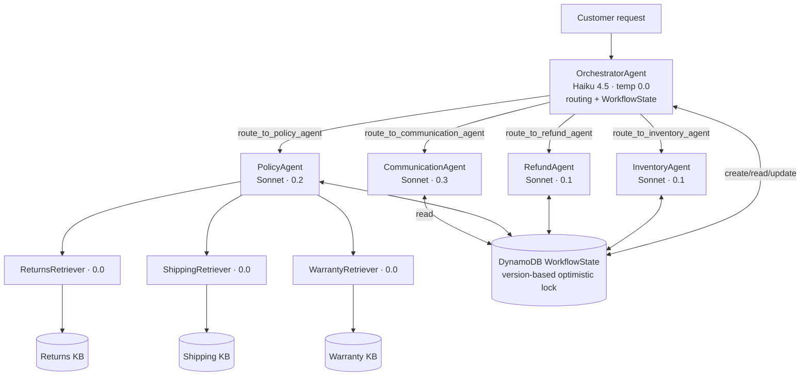
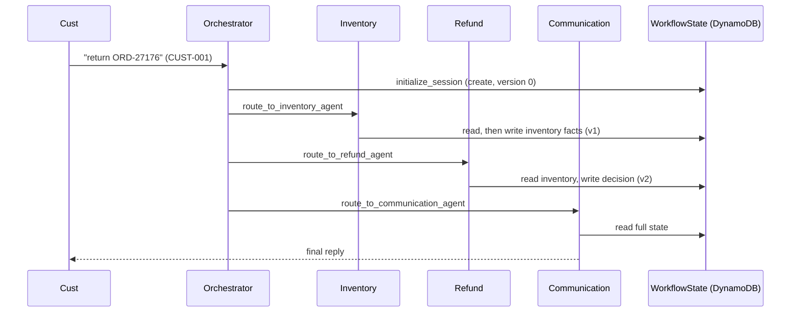

# Architecture

## Agent graph

## AWS resources

| Resource | Name / pattern | Created by |
|---|---|---|
| DynamoDB orders | `udacity-agentcore-orders` (PK `customer_id`, SK `order_id`) | stack |
| DynamoDB customers | `udacity-agentcore-customers` (PK `customer_id`) | stack |
| DynamoDB workflow state | `udacity-agentcore-workflow-state` (PK `session_id`, `version`) | stack |
| S3 policy docs | `udacity-agentcore-policy-docs-<acct>-<suffix>` | stack + seed |
| S3 Vectors bucket | `udacity-agentcore-vectors-…` | stack |
| Vector indexes ×3 | `returns-policy-index`, `shipping-policy-index`, `warranty-policy-index` | stack |
| IAM exec role | AgentCore runtime execution role | stack |
| CloudWatch log group | `/aws/bedrock/agentcore/udacity-agentcore` | stack / observability |
| Bedrock Guardrail | `udacity-agentcore-guardrail` (numbered version) | `create_guardrail` |
| AgentCore Runtime | `udacity_agentcore_runtime` | AgentCore CLI (`deploy`) |
| AgentCore Memory | `udacity_agentcore_memory*` (session summary, 7d) | `configure_memory` |
| Bedrock KBs ×3 | `novamart-{returns,shipping,warranty}-policy-kb` | `create_knowledge_bases.py` |

Resource names are resolved from CloudFormation **exports** by `config.py` (lazy, cached). KB IDs,
runtime ARN, and guardrail id/version live in `.env`.

## Request flow (sequence)

## Deployment pipeline (`python src/agent_orchestrator.py deploy`)

1. Build the 5-agent graph locally.
2. `create_guardrail()` → numbered version.
3. `deploy_to_agentcore_runtime()` → AgentCore CLI stages `build/runtime/`, writes
   `agentcore/agentcore.json`, runs `agentcore deploy -y` (CDK). First run bootstraps CDK.
4. `configure_memory()` → AgentCore Memory (session summary, 7-day).
5. `configure_observability()` → CloudWatch Transaction Search + X-Ray + runtime env vars (this
   re-runs `agentcore deploy`, so it must come **after** step 3).
6. Gateway (optional, skipped — no Lambda tool functions configured).

## Observability path

Each request opens one X-Ray segment (`NovaMart-Orchestrator`). The traced `@tool` decorator
(`agent_observability.py`) opens a remote subsegment per `route_to_*` tool (→ worker node) and per KB
retrieval (→ `KnowledgeBase:*` node). Segments are published with `xray:PutTraceSegments` both locally
and inside the runtime, so the Service Map shows the full Orchestrator → workers → KB call chain.
