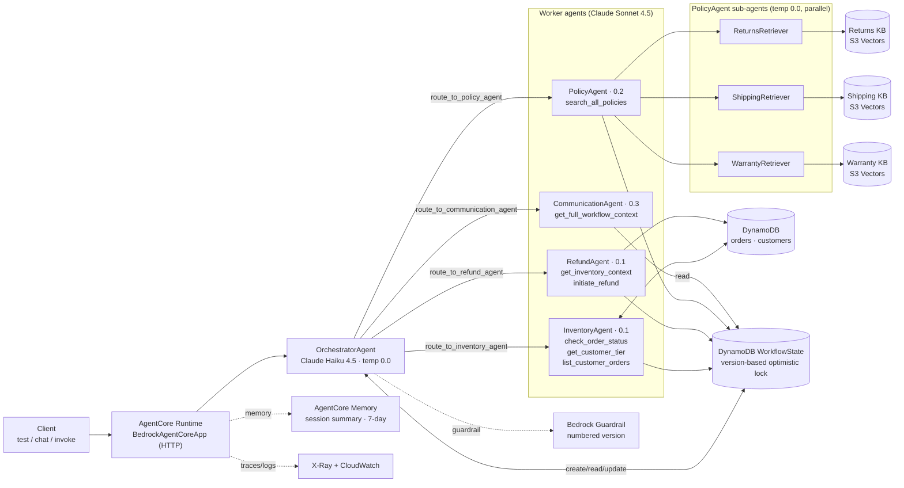
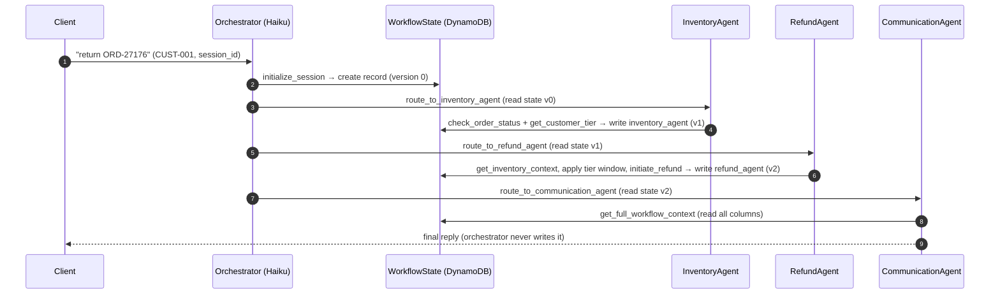
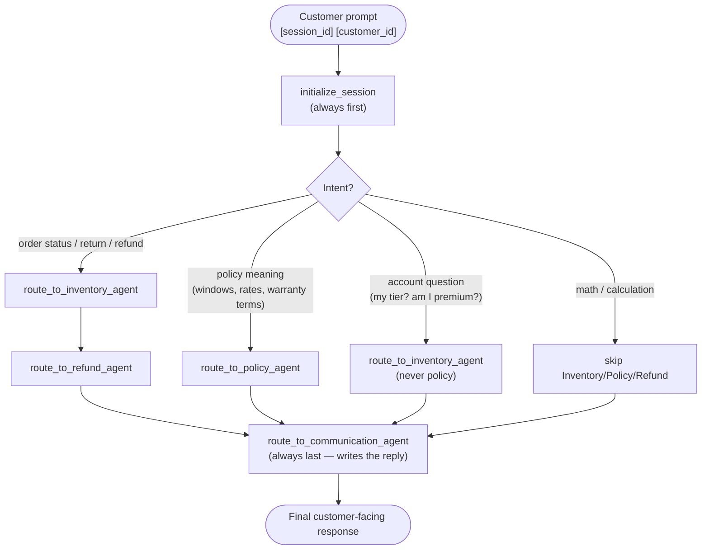
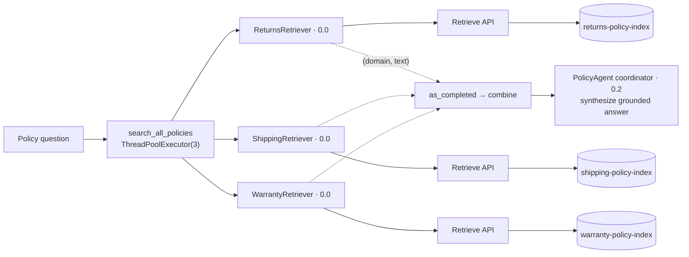
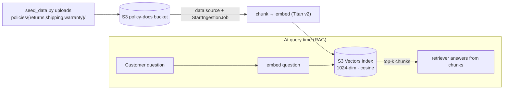
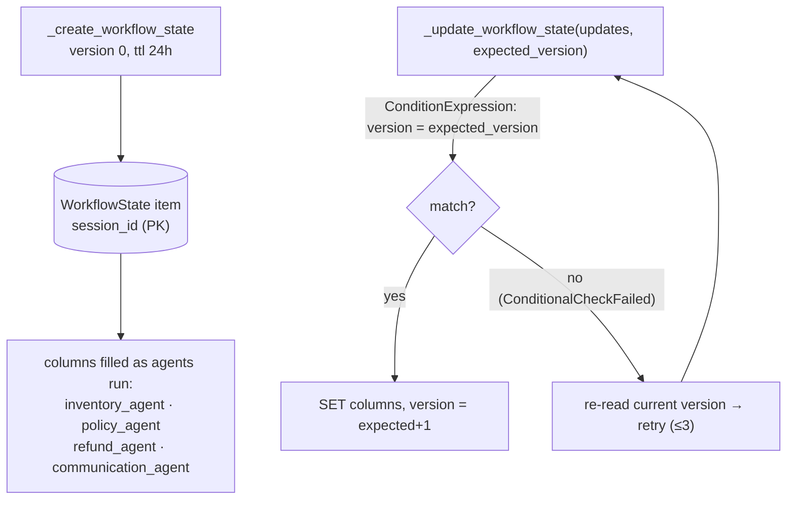
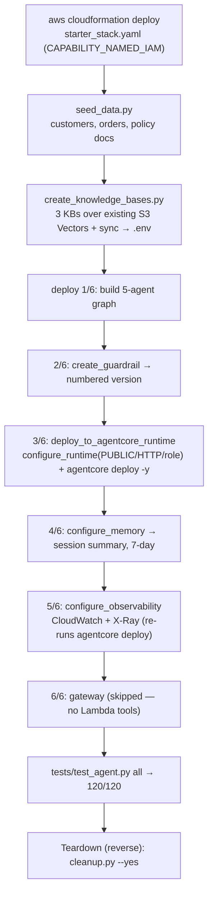
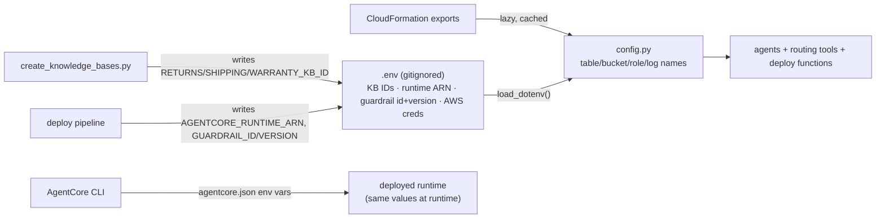
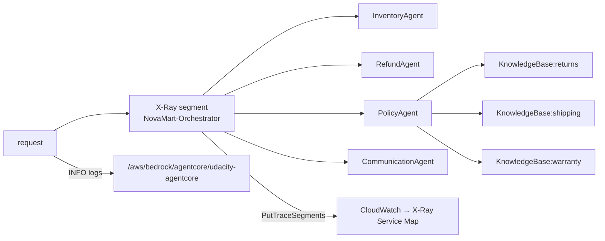

# Architecture — NovaMart Multi-Agent Customer Support

Mermaid diagrams and notes for the AgentCore + Strands support system. The diagrams are text so they
diff cleanly and render on GitHub. The authoritative design is in
[`../.kiro/specs/novamart-multi-agent/design.md`](../.kiro/specs/novamart-multi-agent/design.md); the
build log is [`BUILD_LOG.md`](BUILD_LOG.md).

---

## (a) System architecture

The system runs in AgentCore Runtime. The OrchestratorAgent (Haiku) routes each request to one of four
Sonnet workers; PolicyAgent is itself three retriever sub-agents, one per Knowledge Base. The workers
don't call each other — they share one DynamoDB `WorkflowState` record, with a `version` field for
optimistic locking. The guardrail is on every agent's model; AgentCore Memory keeps a per-session
summary; X-Ray and CloudWatch trace and log each request.

Everything except the foundation CloudFormation stack (DynamoDB, S3, S3 Vectors, IAM role, log group)
is created from code: `src/agent_orchestrator.py` for the guardrail, runtime, memory, and
observability, and `infrastructure/create_knowledge_bases.py` for the three KBs. The runtime itself is
deployed by the AgentCore CLI.

---

## (b) Single-request flow (return scenario)

A return request routes `initialize_session → Inventory → Refund → Communication`. Each worker reads
the current `WorkflowState`, does its part, and writes its result back under its own column with a
version bump. Communication runs last and writes the only text the customer sees.

---

## (c) Orchestrator routing decision

The orchestrator runs at temperature 0 so routing is repeatable. It routes on intent per the six
system-prompt rules. `initialize_session` always runs first; `route_to_communication_agent` always
runs last.

Rule 4 is the one worth calling out: account/tier questions go to Inventory (it has the customer
data), not Policy (which only has policy text). Rule 5 keeps plain arithmetic away from the data
workers but still routes the answer through Communication.

---

## (d) Parallel multi-agent RAG — PolicyAgent

A policy question calls `search_all_policies`, which runs the three retriever sub-agents at the same
time via `ThreadPoolExecutor(max_workers=3)` + `as_completed()`. Each retriever hits one Knowledge
Base (the Retrieve API over an S3 Vectors index); the coordinator combines the three results into one
answer. Because they overlap, the fan-out takes about as long as the slowest single retrieval instead
of all three added up.

### How the KBs are populated (ingestion)

Policy documents are seeded to one S3 bucket under three prefixes. Each Knowledge Base ingests its
prefix: chunk → embed with Amazon Titan Text Embeddings v2 → store vectors in its S3 Vectors index.
At query time the Retrieve API embeds the question and returns the top-k matching chunks.

The KB content is a snapshot from ingestion time. `infrastructure/create_knowledge_bases.py` is safe
to re-run — it reuses KBs that already exist and only re-syncs when needed.

---

## (e) Shared WorkflowState & optimistic locking

Per-request state lives in one DynamoDB item keyed by `session_id`. Each worker writes to its own
column, and every write is a conditional update guarded by `version`. If two writers race, the one
whose version is stale fails the condition, re-reads, and retries.

---

## (f) Deployment / provisioning order (all code)

Resources are created in dependency order, then torn down in reverse. The order in `deploy_all()`
matters in one place: `configure_observability` re-runs `agentcore deploy` to push env vars, so it has
to come after the runtime already exists.

The first `agentcore deploy` also bootstraps CDK (the `CDKToolkit` stack). Teardown is best-effort and
safe to re-run — run it twice to let the async KB/AgentCore deletes finish.

---

## (g) Configuration & credentials flow

`config.py` is the read side: resource names come from CloudFormation exports (resolved lazily and
cached); the KB IDs, runtime ARN, and guardrail id/version come from `.env`. The provisioning scripts
write those IDs back into `.env` once they exist. The sandbox credentials also live in `.env`, which
is gitignored.

So there's one place each value comes from: CloudFormation owns the resource names, the provisioning
scripts own the IDs they create, and both feed the same `.env` + `config.py` that local runs and the
deployed runtime read.

---

## AWS resources (reference)

| Resource | Name / pattern | Created by |
|---|---|---|
| DynamoDB orders | `udacity-agentcore-orders` (PK `customer_id`, SK `order_id`) | stack |
| DynamoDB customers | `udacity-agentcore-customers` (PK `customer_id`) | stack |
| DynamoDB workflow state | `udacity-agentcore-workflow-state` (PK `session_id`, `version`) | stack |
| S3 policy docs | `udacity-agentcore-policy-docs-<acct>-<suffix>` | stack + seed |
| S3 Vectors bucket | `udacity-agentcore-vectors-…` | stack |
| Vector indexes ×3 | `returns-policy-index`, `shipping-policy-index`, `warranty-policy-index` | stack |
| IAM exec role | `udacity-agentcore-agentcore-role` | stack |
| CloudWatch log group | `/aws/bedrock/agentcore/udacity-agentcore` | stack / observability |
| Bedrock Guardrail | `udacity-agentcore-guardrail` (numbered version) | `create_guardrail` |
| AgentCore Runtime | `udacity_agentcore_runtime` | AgentCore CLI (`deploy`) |
| AgentCore Memory | `udacity_agentcore_memory*` (session summary, 7d) | `configure_memory` |
| Bedrock KBs ×3 | `novamart-{returns,shipping,warranty}-policy-kb` | `create_knowledge_bases.py` |

---

## (h) Observability path

Each request opens one X-Ray segment (`NovaMart-Orchestrator`). The traced `@tool` decorator
(`agent_observability.py`) opens a remote subsegment per `route_to_*` tool (the worker nodes) and per
KB retrieval (the `KnowledgeBase:*` nodes), which is what draws the full chain on the Service Map.
Segments are published with `xray:PutTraceSegments` the same way from local runs (`test`/`chat`/`demo`)
and from inside the deployed runtime (`invoke`). INFO logs go to the project CloudWatch log group.

